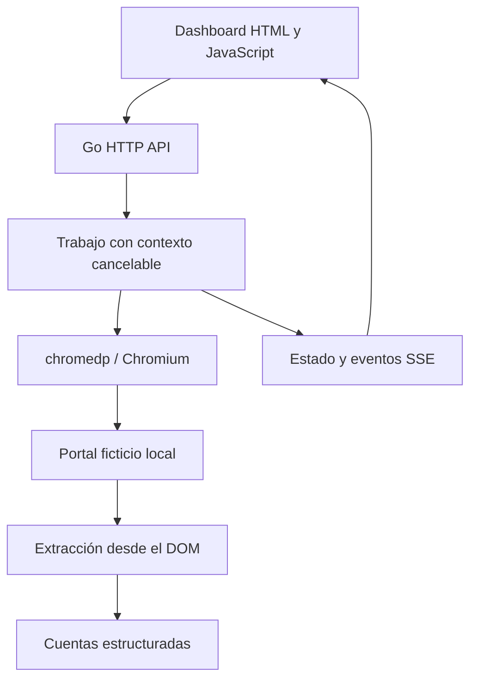

# Browser Automation Lab

A Go + chromedp application by **Camilo Fuentealba** that drives a real Chromium browser against a self-contained fictional account portal. Includes a dashboard, live progress, a transient failure scenario, timeout and cancellation.

## Ejecutar con Docker

Requisito: Docker con Compose v2.

```bash
cd projects/browser-automation-lab
docker compose up --build
```

Abre **http://localhost:8080**. El contenedor incluye Chromium y el binario Go. No necesita cuentas ni servicios bancarios.

## Ejecutar sin Docker

Requisitos: Go 1.25+ y Chrome o Chromium instalado.

```bash
cd projects/browser-automation-lab
go mod download
go run .
```

Si no encuentra el navegador, configura `CHROME_BIN` con su ruta. En Linux suele ser `/usr/bin/chromium` o `/usr/bin/google-chrome`. El puerto se cambia con `PORT` (por defecto 8080). El modo Docker desactiva el sandbox de Chromium dentro del contenedor; en ejecución local se mantiene habilitado por defecto.

## Recorrido de demostración

1. Abre el portal de prueba para ver su HTML y las credenciales ficticias `demo / demo123`.
2. Ejecuta **Consulta exitosa**: se abre Chromium, completa el formulario, espera las cuentas y extrae sus nombres y saldos desde el DOM.
3. Ejecuta **Fallo temporal y reintento**: el primer acceso muestra indisponibilidad; se detecta y se intenta otra vez después de 700 ms.
4. Ejecuta **Respuesta lenta y timeout**: el portal espera 30 segundos; el contexto completo vence a los 18 segundos.
5. Ejecuta ese mismo escenario y pulsa **Cancelar**. El contexto cancela el trabajo y libera el navegador.
6. Recarga la página durante una ejecución para recuperar el seguimiento en la misma sesión del navegador.

## Arquitectura



### Decisiones técnicas

- El destino es fijo y local. La API acepta un escenario, no una URL arbitraria.
- Un único trabajo activo evita saturación de navegadores. Otro inicio recibe HTTP 429 hasta liberar el anterior.
- Contextos con deadline y cancelación explícita controlan el ciclo de vida del navegador.
- Estado protegido con mutex; los snapshots copian los slices y un estado final no se sobrescribe.
- Los eventos incluyen secuencia y hora. SSE envía snapshots completos para facilitar reconexión; la UI consulta cada dos segundos como respaldo.
- Máximo de 30 ejecuciones conservadas en memoria; se pierden al reiniciar. Esta app no declara persistencia ni escalado horizontal.
- Solo el fallo transitorio identificado provoca reintento. No se repiten errores indiscriminadamente.
- El backend Go y los archivos estáticos se empaquetan en un único binario con `embed`.

## API

| Método y ruta | Uso |
| --- | --- |
| `GET /api/health` | Estado |
| `POST /api/runs` | `{"scenario":"success"}`, `retry` o `timeout` |
| `GET /api/runs/:id` | Snapshot de estado, eventos y cuentas |
| `GET /api/runs/:id/events` | Stream SSE |
| `POST /api/runs/:id/cancel` | Cancelar contexto del trabajo |

## Pruebas

```bash
go test -race ./...
# Requiere Chromium. Se ejecutan cuatro recorridos reales:
BROWSER_TESTS=1 go test -v ./...
```

Si el entorno requiere desactivar el sandbox del navegador, usa `CHROME_NO_SANDBOX=1` solo para ese entorno aislado. La CI lo configura explícitamente.

Las pruebas básicas verifican inmutabilidad del estado final, secuencia de eventos concurrentes, copias de snapshots, validación del contrato, exclusión de URL externa, HTTP 429 y trabajos inexistentes. Las pruebas de navegador cubren éxito, reintento, timeout y cancelación.

## Alcance

Proyecto demostrativo de una sola instancia, sin autenticación ni almacenamiento durable. Compose publica solo en localhost. No utiliza bancos, datos de clientes ni código de empleadores. El frontend es HTML/JavaScript sin framework para mantener el foco de esta app en Go y el ciclo de vida de la automatización; Angular está demostrado en Payment Flow Lab.

## Autor

[Camilo Fuentealba](https://github.com/camiloandresf) · [LinkedIn](https://www.linkedin.com/in/camilo-andres-f/)
