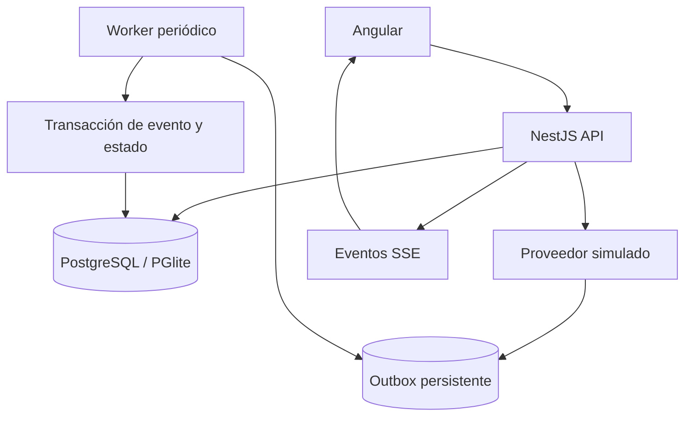

# Payment Flow Lab

A runnable Full Stack payment simulation by **Camilo Fuentealba**. Built to demonstrate backend correctness, integration design and Angular development. No real payment provider or money is involved.

## Qué puedes probar

1. Crear una orden en CLP y repetir la misma solicitud sin duplicarla.
2. Encolar una aprobación o rechazo del proveedor ficticio.
3. Observar el estado por eventos SSE, con consulta periódica como respaldo.
4. Reenviar el webhook firmado: se reconoce el duplicado sin repetir la transición.
5. Consultar eventos, intentos y errores de la cola por orden.

## Ejecutar con Docker

Requisito: Docker con Compose v2.

```bash
cd projects/payment-flow-lab
docker compose up --build
```

Abre **http://localhost:4200**. La API queda en http://localhost:3000/api/health. PostgreSQL se inicia con healthcheck y conserva los pagos en un volumen.

```bash
docker compose down
# Para eliminar también los datos de prueba:
docker compose down -v
```

## Ejecutar sin Docker

Requisito: Node.js 24. Abre dos terminales:

```bash
# Terminal 1
cd projects/payment-flow-lab/api
npm ci
npm run build
npm start
```

```bash
# Terminal 2
cd projects/payment-flow-lab/web
npm ci
npm start
```

Abre http://localhost:4200. Sin `DATABASE_URL`, la API usa **PGlite**, motor PostgreSQL embebido, persistido en `api/data/`. No usa una lista de pagos en memoria. Con `DATABASE_URL`, usa PostgreSQL mediante `pg`.

## Arquitectura y decisiones



- **Idempotencia:** clave única en base de datos y huella del payload normalizado. Una repetición devuelve la misma orden; otros datos con la misma clave producen HTTP 409.
- **Importes:** enteros CLP entre 1 y 10.000.000, sin cálculos de dinero en coma flotante.
- **Máquina de estados:** `pending → approved | rejected`. Un estado final no puede cambiarse por otro evento.
- **Webhooks:** HMAC SHA-256 del cuerpo HTTP exacto; comparación en tiempo constante. `eventId` único y comprobación de contenido.
- **Asincronía:** outbox SQL, sin RabbitMQ en esta versión. El worker usa `FOR UPDATE SKIP LOCKED`; aplicación del evento y confirmación de la cola comparten transacción. Un error usa savepoint, backoff exponencial y un máximo de cinco intentos. Los agotados quedan consultables en la auditoría.
- **Consistencia:** restricciones únicas y bloqueo de la fila del pago, además de validación de aplicación. No se promete entrega exactamente una vez; los efectos se deduplican.
- **SSE:** notificación en memoria para actualizar la UI. No es un log durable. La UI vuelve a consultar la base cada cinco segundos.

El simulador devuelve un evento firmado para permitir probar su reenvío sin mostrar el secreto. Esto es una herramienta de prueba, no autenticación de usuarios.

## API

| Método y ruta | Uso |
| --- | --- |
| `GET /api/health` | Estado y modo de base de datos |
| `GET /api/payments` | Últimas 100 órdenes |
| `POST /api/payments` | Crear; header `Idempotency-Key` requerido |
| `POST /api/payments/:id/simulate` | Encolar `{"status":"approved"}` o `rejected` |
| `POST /api/webhooks/provider` | Recibir evento con header `X-Signature` |
| `GET /api/payments/:id/audit` | Eventos e intentos de procesamiento |
| `GET /api/events` | Actualizaciones SSE |

Ejemplo:

```bash
curl -X POST http://localhost:3000/api/payments \
  -H 'Content-Type: application/json' \
  -H 'Idempotency-Key: order-demo-001' \
  -d '{"reference":"Orden demo","amount":15990}'
```

## Pruebas

```bash
cd api
npm ci
npm run build
npm test
# Con la API iniciada en otra terminal:
node src/http-smoke.mjs
```

Las pruebas cubren concurrencia con la misma clave, payload incompatible, importes inválidos, firma incorrecta, duplicado de webhook, estado final, colisión de evento, reanudación del worker y reintentos. El smoke HTTP comprueba el contrato real de los endpoints y el procesamiento asíncrono.

## Alcance de esta versión

Demo local sin autenticación, cuentas de usuario, conciliación, reembolsos ni conexión a Mercado Pago o MACH. Compose expone los puertos solo en localhost. No introducir credenciales ni pagos reales. Para un servicio público faltan autenticación, límites por usuario, observabilidad y gestión de secretos. RabbitMQ y un contrato OpenAPI son extensiones futuras, no funcionalidades ya implementadas.

## Autor

[Camilo Fuentealba](https://github.com/camiloandresf) · [LinkedIn](https://www.linkedin.com/in/camilo-andres-f/)
